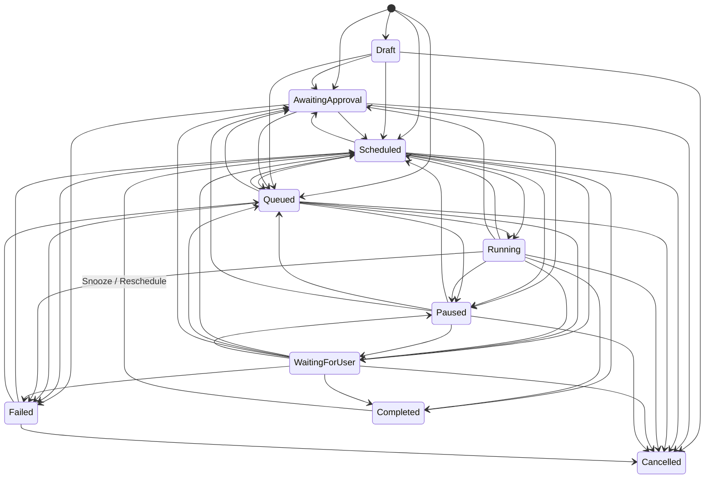

# JARVIS — Phase 4 Completion Report: Persistent Task Engine, Scheduling & Reminders

**Date:** 2026-11-01  
**Project Root:** `C:\Users\Gurkirat Singh\Desktop\jarvis`  
**Phase Status:** Complete (225 / 225 automated tests passing; 11 / 11 live demonstrations verified; Visual QA passed at 1280px, 768px, and 375px with 0 console errors)

---

## 1. Executive Summary

Phase 4 extends the local-first Jarvis AI Assistant with a centralized **Persistent Task Engine, Background Scheduler, Timezone-Aware Recurrence Calculator, Safe Recovery Engine, and Persistent Local Notification System** backed by the existing SQLite WAL database (`data/jarvis.db`), Phase 3 `ToolRegistry`, and 3-level `PermissionManager`.

Key capabilities delivered in Phase 4:
- **Centralized Persistent Task Engine (`backend/tasks.py`, `backend/db.py`):** Full lifecycle management for tasks across a validated 10-state machine (`Draft`, `AwaitingApproval`, `Scheduled`, `Queued`, `Running`, `WaitingForUser`, `Paused`, `Completed`, `Failed`, `Cancelled`) with transactional SQLite state transitions, execution leases, step-level checkpoints, and duplicate active task prevention (`dedup_key`).
- **Four Task Categories:**
  1. `reminder` — One-time, daily, weekly, and monthly timezone-aware reminders with completion/dismissal and snoozing (`snooze_reminder`). **Reminders trigger directly from the scheduler without invoking or loading the local LLM (`used_model = False`).**
  2. `local_task` — Multi-step or single-step local processing tasks using approved Phase 3 tools (`calculate`, `workspace_list_files`, `workspace_read_file`, `workspace_create_file`, `workspace_write_file`, `get_system_info`, date/time tools). Arbitrary shell/command execution remains strictly prohibited.
  3. `research_task` — Scheduled web research tasks (`web_search`, `fetch_webpage`). If `offline_mode = True` when a `research_task` becomes due, it transitions to `Paused` (`outcome = "paused_offline"`) with a clear explanation and a `paused_offline` notification—never silently enabling Online Mode.
  4. `followup` — Explicit user-requested follow-up reminders. Jarvis never invents unrequested follow-ups from ordinary conversation.
- **Timezone-Aware Scheduling & Missed-Execution Coalescing:** Stores canonical UTC timestamps alongside the task's IANA timezone (defaulting to the system timezone `Asia/Kolkata`, `UTC+05:30`), computes `daily`, `weekly`, and `monthly` recurrences (with calendar month-end day clamping), detects overdue tasks (`deadline_at`), and coalesces missed recurring runs after downtime so a backlog of missed occurrences never floods the system at startup.
- **Crash Recovery, Lease Locking & Non-Idempotent Mutation Guard:** Atomic SQLite lease acquisition (`lease_owner`, `lease_expires_at`) prevents concurrent duplicate execution. On startup or stale-lease expiration, `recover_tasks()` safely reschedules idempotent/read-only tasks from their last persisted checkpoint (`checkpoint_json`) while transitioning interrupted uncheckpointed `Level 2` mutating tasks to `WaitingForUser` so file writes are never blindly repeated.
- **Execution-Time Permission Revalidation:** Reuses the Phase 3 `PermissionManager`. Tasks requiring `Level 2` (`MUTATING_LOCAL`) tools start in `AwaitingApproval`, revalidate approval status and TTL immediately before execution, and require fresh approval for each subsequent occurrence of a recurring mutating task.
- **Persistent Notifications & Responsive UI:** SQLite-persisted `notifications` table with deduplication (`dedup_key`), read/unread tracking, dismissal, and task/execution linkage, surfaced through the new **Tasks, Scheduling & Reminders** modal, **Notifications & Reminders** modal, topbar live badges, and natural-language chat commands.

---

## 2. Pre-Change Audit Findings

1. **Workspace & Git Verification:** Confirmed working directory and Git root at `C:\Users\Gurkirat Singh\Desktop\jarvis`. Older unrelated projects were untouched.
2. **Prior Phase Reports & Regression Suite:** Reviewed `PHASE_1_REPORT.md` (72 tests), `PHASE_2_REPORT.md` (32 tests), and `PHASE_3_REPORT.md` (102 tests). Ran the pre-change regression suite: **`206 passed in 34.24s`**.
3. **Database & Service Inspection:** Inspected `data/jarvis.db` (`conversations`, `messages`, `settings`, `memories`, `tool_executions`, `tool_approvals`, `schema_migrations` versions 1–3) and identified clean integration points in `backend/db.py`, `backend/tools.py`, `backend/permissions.py`, `backend/services.py`, `backend/app.py`, and `frontend/`.

---

## 3. Database Schema & Migrations (`data/jarvis.db`)

Added schema migration **`4: 004_phase4_tasks_executions_notifications`** in [`backend/db.py`](file:///C:/Users/Gurkirat%20Singh/Desktop/jarvis/backend/db.py):

### 3.1 `tasks` Table
| Column | Type | Purpose |
|---|---|---|
| `id` | `TEXT PRIMARY KEY` | 32-char lowercase hex task ID |
| `title` | `TEXT NOT NULL` | Human-readable task or reminder title |
| `description` | `TEXT NOT NULL` | Optional notes or task instructions |
| `task_type` | `TEXT NOT NULL` | `reminder`, `local_task`, `research_task`, or `followup` |
| `priority` | `INTEGER NOT NULL` | Priority `1` (Highest) through `5` (Lowest), default `3` |
| `state` | `TEXT NOT NULL` | Validated 10-state machine value |
| `timezone` | `TEXT NOT NULL` | IANA timezone name (e.g. `Asia/Kolkata`, `UTC`) |
| `scheduled_at` | `TEXT` | Initial scheduled UTC ISO-8601 timestamp |
| `next_run_at` | `TEXT` | Next scheduled execution UTC ISO-8601 timestamp |
| `last_run_at` | `TEXT` | Most recent execution UTC ISO-8601 timestamp |
| `deadline_at` | `TEXT` | Optional deadline UTC ISO-8601 timestamp for overdue detection |
| `recurrence_json` | `TEXT NOT NULL` | JSON object (`type`: `none`/`daily`/`weekly`/`monthly`, `interval`, `weekday`, `day_of_month`) |
| `retry_count` / `max_retries` | `INTEGER NOT NULL` | Current retry counter and bounded retry limit (`0..10`) |
| `timeout_seconds` | `REAL NOT NULL` | Per-execution timeout bound (`0.05..3600s`) |
| `action_json` | `TEXT NOT NULL` | Validated tool call (`tool_name`, `arguments`) or multi-step `steps` list |
| `requires_approval` | `INTEGER NOT NULL` | `1` if any step requires `Level 2` user approval |
| `approval_id` | `TEXT` | Foreign-key reference to `tool_approvals(id)` |
| `checkpoint_json` | `TEXT` | Step-level checkpoint (`completed_steps`, `step_results`, `output_refs`) |
| `last_error` | `TEXT` | Most recent failure, block, or recovery explanation |
| `dedup_key` | `TEXT` | Deterministic signature preventing duplicate active task creation |
| `lease_owner` / `lease_expires_at` | `TEXT` | Worker lease lock preventing duplicate concurrent execution |
| `conversation_id` | `TEXT` | Optional linked conversation (`ON DELETE SET NULL`) |
| `metadata_json` | `TEXT NOT NULL` | Structured metadata (overdue flags, missed-run coalescing stats) |
| `created_at` / `updated_at` | `TEXT NOT NULL` | UTC ISO-8601 timestamps |

### 3.2 `task_executions` Table
Records every execution attempt (`id`, `task_id`, `started_at`, `finished_at`, `retry_number`, `outcome`, `tool_calls_json`, `error_details`, `output_summary`, `output_refs_json`, `resource_usage_json`) with cascade delete on `tasks(id)`.

### 3.3 `notifications` Table
Stores persistent local alerts (`id`, `task_id`, `execution_id`, `kind`, `title`, `message`, `severity`, `created_at`, `read_at`, `dismissed_at`, `dedup_key`, `metadata_json`) with unique index on `dedup_key`.

---

## 4. Task State Machine & Validation

Every state change in [`Database.transition_task_state`](file:///C:/Users/Gurkirat%20Singh/Desktop/jarvis/backend/db.py) is validated against `VALID_TASK_TRANSITIONS`:

Invalid transitions (such as transitioning a `Cancelled` task to `Running`) raise `InvalidTaskTransitionError` (HTTP `409 Conflict`).

---

## 5. Scheduler, Recurrence, Timezones & Recovery (`backend/tasks.py`)

- **Timezone Resolution (`resolve_tz`):** Supports system local timezone (`Asia/Kolkata` on this machine), any IANA timezone (`America/New_York`, `Europe/London`, `UTC`, etc.), and fixed `UTC±HH:MM` offsets. All API responses include both UTC (`scheduled_at`, `next_run_at`) and local ISO timestamps (`scheduled_at_local`, `next_run_at_local`).
- **Recurrence Calculation (`compute_next_occurrence`):**
  - `daily`: Advances by `interval` days in the task's local timezone.
  - `weekly`: Advances to the target `weekday` (`0=Monday .. 6=Sunday`) or by `7 * interval` days.
  - `monthly`: Advances by `interval` months while clamping `day_of_month` to `calendar.monthrange(year, month)[1]` (so a Jan 31 monthly task runs on Feb 28/29 and returns to Mar 31).
- **Missed Execution Coalescing:** If the application was closed across multiple recurring intervals, `compute_next_occurrence(..., after=now)` coalesces all past occurrences into a single immediate run and sets `next_run_at` strictly in the future, recording `coalesced_missed_occurrences` in execution metadata.
- **Startup & Stale-Lease Recovery (`recover_tasks`):**
  - Marks dangling `running` execution rows as `recovered_interrupted`.
  - If a task has an uncheckpointed `Level 2` (`MUTATING_LOCAL`) step, transitions the task to `WaitingForUser` and emits a `recovery_notice` warning notification rather than risking duplicate file modification.
  - Otherwise increments `retry_count` (up to `max_retries`) and reschedules the task from its last saved step checkpoint (`checkpoint_json`).

---

## 6. Eleven Required Live Demonstrations (Verified on `data/jarvis.db`)

All 11 required demonstrations from Section 14 were executed against `data/jarvis.db` and recorded in `phase4_demo_and_qa_results.json`:

| # | Demonstration Requirement | Verification Result |
|---|---|---|
| **1** | Create a reminder | Created `[Phase 4 Demo] Revise DSA Graph Algorithms` (`id=32ee9f854fe54d53854f1af3c57827d3`, `state="Scheduled"`, `scheduled_at_local="2026-11-01T19:00:00+05:30"`, `timezone="Asia/Kolkata"`). |
| **2** | Confirm it is stored in SQLite | Direct `SELECT` on `tasks` confirmed row `32ee9f854fe54d53854f1af3c57827d3` (`task_type="reminder"`, `state="Scheduled"`, `scheduled_at="2026-11-01T13:30:00.000000+00:00"`). |
| **3** | Restart the application and verify reminder still exists | Closed `Database`, reopened `data/jarvis.db` and `TaskEngine`: task `32ee9f854fe54d53854f1af3c57827d3` persisted with `state="Scheduled"` and `next_run_at_local="2026-11-01T19:00:00+05:30"`. |
| **4** | Trigger the reminder using a short schedule or deterministic test clock | Advanced deterministic clock past `19:00:00+05:30` and ran `scheduler.tick()`: `executed_count=1`, `state="Completed"`, `outcome="completed"`, **`used_model=False`** (zero LLM inference). |
| **5** | Create a recurring reminder and verify next execution time calculation | Created weekly Sunday reminder `[Phase 4 Demo] Weekly Sunday Progress Review` (`id=28e0d2457c32441daf78a6069d5a5666`); after triggering first run at `2026-11-01T21:05:00+05:30`, task remained `Scheduled` with `next_run_local="2026-11-08T21:05:00+05:30"`. |
| **6** | Create and execute a local processing task using an existing Phase 3 tool | Executed 2-step `local_task` (`id=3ca168e1817840758d376be64ffd0ab3`) calling `calculate("256 * 16 + 48")` and `workspace_list_files()`: `state="Completed"`, `steps_executed=2`, `output_summary="calculate(256 * 16 + 48) = 4144; Listed 3 file(s) in workspace/."`. |
| **7** | Demonstrate permission enforcement for a restricted task | Created mutating `local_task` (`workspace_write_file` -> `study_plan_summary.md`, `id=0bcc8f6e1d07431bb44d2c6d04047a50`): started in `state="AwaitingApproval"` (`approval_id=f98f3a5c4032470a94935ec111532579`); after `approve_task()`, transitioned to `Scheduled`, executed, and completed (`Overwritten workspace/study_plan_summary.md (88 bytes)`). |
| **8** | Pause and resume a scheduled task | Task `56fd5e63dacc473691341dc52bfcac29` (`get_system_info`): `pause_task()` -> `state="Paused"`; `resume_task()` -> `state="Scheduled"` (`next_run_at_local="2026-11-02T01:10:00+05:30"`). |
| **9** | Cancel a pending task | Task `6b575483ef6e4125bd4616de06ada784`: `cancel_task(confirm=True)` -> `state="Cancelled"`, `next_run_at=None`. |
| **10** | Simulate an interrupted task execution and verify safe recovery | Simulated crashed worker lease on `Running` task `0f833d87703549de93cbe4a992a0b885`; `recover_tasks(startup=True)` marked the dangling execution `recovered_interrupted`, transitioned the task to `Scheduled`, emitted a `recovery_notice` notification, and completed cleanly on its rescheduled run. |
| **11** | Verify notifications persist after restart | Closed and reopened `data/jarvis.db`: verified `9` persisted notifications across kinds `reminder_due`, `task_completed`, `approval_required`, `recovery_notice`, and `paused_offline`. |

---

## 7. Automated Test Suite & Visual QA Results

### 7.1 Full Pytest Suite (`225 passed`)
Command: `py -3.12 -m pytest -v`
- **Phase 1 Foundation & Live GPU Inference Tests:** 72 passed
- **Phase 2 SQLite History, Context, Memory & Settings Tests:** 32 passed
- **Phase 3 Tool Registry, Permissions, Sandbox & Web Research Tests:** 102 passed
- **Phase 4 Task Engine, Scheduling, Execution, Permissions, Notifications & API Tests:** 19 comprehensive end-to-end test suites passed (`tests/test_phase4_db_and_scheduling.py` and `tests/test_phase4_execution_and_api.py`)
- **Total:** **`225 passed, 0 failed, 0 skipped in 41.21s`**

### 7.2 Headless Chrome Visual QA (`1280px`, `768px`, `375px`)
Inspected the live UI across all three required viewports using headless Chrome CDP:
- `p4_tasks_modal_desktop_1280.png` (`1280x840`): `horizontal_overflow = False`
- `p4_tasks_modal_tablet_768.png` (`768x1024`): `horizontal_overflow = False`
- `p4_tasks_modal_mobile_375.png` (`375x812`): `horizontal_overflow = False`
- `p4_notifications_modal_1280.png` (`1280x840`): `horizontal_overflow = False`
- Single `<h1>` verified, `<html lang="en">` verified, and **0 browser console errors**.

---

## 8. Known Limitations & Phase 5 Readiness

1. **Application-Scoped Background Scheduler:** As required by Section 4, the background `TaskScheduler` runs only while the Jarvis FastAPI server process is running; it does not install Windows Task Scheduler entries, startup registry keys, or hidden OS services. Missed schedules while the server is stopped are safely coalesced and recovered on next startup.
2. **Bounded Tool Scope:** Scheduled and background tasks can only invoke tools registered in the Phase 3 `ToolRegistry`; arbitrary shell commands and unapproved file writes remain impossible.
3. **Phase 5 Readiness:** The SQLite schema (`version 4`), `TaskEngine`, `TaskScheduler`, `NotificationService`, and `ToolRegistry` are cleanly modularized and ready for future extensions.
